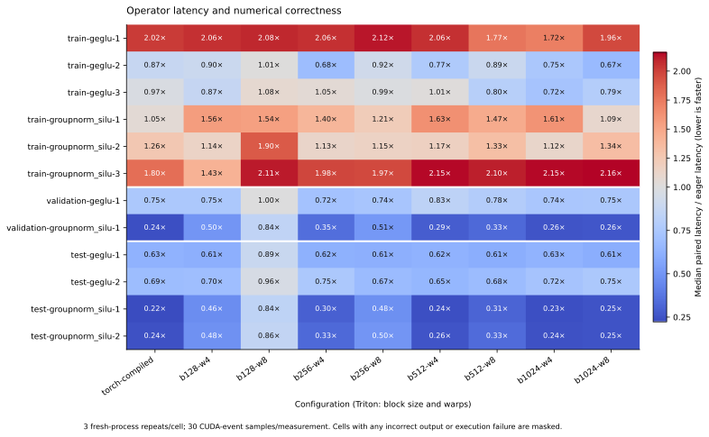

# Results

## Operator configuration benchmark

The [RTX PRO 4500 dataset](results/2026-11-20-operator-search-rtx-pro-4500/README.md) contains **360 GPU measurements** across 12 workloads, nine configurations and an eager reference. Three fresh processes per cell record latency, allocated memory and numerical correctness. All recorded checks passed.

[Measured table](results/2026-11-20-operator-search-rtx-pro-4500/table.json) · [Reproduction instructions](docs/measured-operator-search.md)

## Search policies

Fixed compiled settings, grid, random and two pretrained LLM selectors used four trials per episode. Neither LLM reduced mean table regret relative to fixed compiled settings in the matched comparison. The dataset retains all 264 policy episodes and separate fresh confirmation: **207 GPU measurements** of the 23 selected task/configuration pairs and their eager/compiled references.

[Policy results and trajectories](results/2026-11-20-operator-search-rtx-pro-4500/README.md#policy-comparison) · [Fresh confirmation](results/2026-11-20-operator-search-rtx-pro-4500/README.md#fresh-confirmation)

Replay queries recorded measurements; policy episodes add no independent GPU samples. Operator numerical checks do not establish video-generation quality.

## Archive

[Earlier datasets and reports](research/archive/README.md) retain their original measurements, protocols and provenance.
