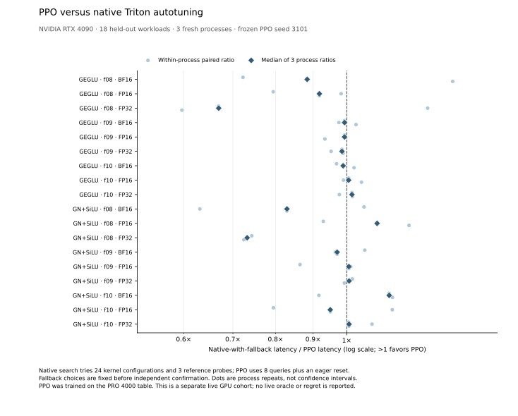

# Results

## Operator configuration benchmark

The [RTX PRO 4000 dataset](results/2026-11-23-operator-generalization-pro-4000/README.md) contains **4,680 GPU measurements**: 60 workloads × 26 configurations including eager × three fresh processes. The candidates comprise 24 Triton block-size/warp-count combinations and compiled PyTorch. All recorded numerical checks passed.

[Download and reproduce](results/2026-11-23-operator-generalization-pro-4000/README.md#download-and-run) · [Gymnasium interface](docs/operator-generalization.md#use-the-gymnasium-interface) · [Frozen protocol](protocols/operator-generalization-v2-compile-isolation-v1.json)

## Live sequential schedule search

On one RTX 4090, a fixed eager/compiled reference, random walks and greedy local search completed 54 episodes across six float16 TEST shape families from GEGLU and GroupNorm+SiLU. Each method received three search/timing seeds per task and a 90-second ceiling including setup, compilation, search, confirmation and cleanup. Workload input seeds were fixed.

| Method | Mean failure-adjusted speed score | Descriptive 95% interval | Confirmed submissions |
| --- | ---: | ---: | ---: |
| Fixed eager/compiled reference | −0.0306 | [−0.1453, 0.0629] | 18/18 |
| Greedy local search | −0.1640 | [−0.3700, 0.0055] | 18/18 |
| Random walk | −0.4346 | [−0.7758, −0.1075] | 12/18 |

Higher scores are better. A confirmed episode scores `clip(1 − selected latency / paired final reference latency, −1, 1)`, using fresh sample medians; failed or unconfirmed episodes score −1. The fixed reference had the highest observed mean. Its paired score difference from greedy search was 0.1333, with interval [−0.0660, 0.3512], which does not establish superiority over greedy search. Intervals use 10,000 paired hierarchical bootstrap draws over six task families and three nested search/timing seeds.

All six failures were random-walk queries on GroupNorm+SiLU families f08 and f10 that reached the full 15-second query timeout; the underlying cause is unknown. No episode exceeded its 90-second ceiling. The methods used 135.7, 827.2 and 823.3 seconds in total for reference, greedy and random episodes, respectively. Greedy and random reached the 128-query safety cap in six and three episodes. The ceiling was shared; actual tuning time differed.

The live kernel and environment validation passed 28 representative CUDA tests. The study measures these two operators on one GPU/runtime cohort; it includes no trained sequential RL policy, exhaustive oracle or end-to-end model comparison. [Data, source, trajectories, figures and CPU reproduction](results/2026-11-26-sequential-schedules/README.md) are separate from the configuration-bandit results below.

## Transfer to RTX 4090

Across 18 test workloads, the mean Spearman rank correlation between RTX PRO 4000 and RTX 4090 configurations was **0.301** (median 0.280). The source-table optimum remained optimal on **6 of 18** workloads. Transferring it produced mean target regret of **0.107481**. Regret is the difference between the selected configuration's median normalized cost and the table minimum; costs normalize latency to the eager reference.

All 1,404 target measurements passed numerical checks. Source choices were fixed before target measurement, and models used their source-trained parameters. The comparison covers one GPU/runtime pair across six constructed shape families.

[Per-workload rankings and transfer data](results/2026-11-23-operator-generalization-pro-4000/README.md#transfer-to-rtx-4090)

## Eight-trial policy comparison

Each method received eight trials on each of 18 held-out workloads, with 20 episodes per workload. Lower regret is better; zero means the selected configuration matches the finite table's best measured cost.

| Policy | Mean final table regret | Repeated actions / 2,880 turns |
| --- | ---: | ---: |
| Compiled-query baseline | 0.027931 | 2,520 |
| Random | 0.055878 | 0 |
| Optuna TPE | 0.031880 | 1,434 |
| Train-only ridge selector | 0.031822 | 0 |

The compiled-query baseline starts with eager, queries compiled and keeps the best configuration observed, including eager. It had the lowest mean regret. Ridge had lower mean regret than random search and similar regret to TPE; their small difference is insufficient to rank the methods reliably. The two LLM selectors ran one episode per workload and appear in a [matched comparison](results/2026-11-23-operator-generalization-pro-4000/README.md#matched-llm-comparison).

All replay comparisons query the same three recorded GPU-process repeats. Their uncertainty is conditional on that finite table. Regret evaluates the selected configuration using all three repeats, so its curve can rise when a noisy observation changes the selection.

## PPO training and held-out evaluation

Five PPO policies each completed 102,400 steps on the 30 training workloads, using recorded GPU observations. Training ended before test evaluation. Each trained policy and one untrained initialization received twenty episodes on each of the eighteen held-out workloads: **2,160 evaluation episodes** in total.

Mean final regret across all five trained policies was **0.035556** (training-seed standard deviation 0.012672). Individual seed means were 0.033024, 0.025118, 0.027289, 0.035376 and 0.056971. The untrained initialization measured 0.218278. TPE and the compiled-query baseline had lower mean regret than PPO.

The paired mean PPO-minus-TPE regret difference is 0.003676, with a descriptive shape-family bootstrap interval of [−0.034030, 0.042650]. The interval uses six held-out shape families and conditions on the recorded measurements and trained checkpoints.

[Training settings and reproduction](docs/ppo-training.md) · [Checkpoints, journals and analysis](results/2026-11-24-ppo-native-autotune/README.md)

## Live PPO and native Triton autotuning

PPO seed 3101, chosen before training, ran on an RTX 4090 over all 18 test workloads in three fresh processes. Native Triton 3.6 autotuning searched all 24 kernel configurations. PPO used eight live queries plus an eager reset. Native search also received three probes to choose among eager, compiled and the selected Triton kernel before independent confirmation.

| Comparator | Comparator / PPO latency | Descriptive 95% interval |
| --- | ---: | ---: |
| Native kernel-only selection | 1.089× | [1.019, 1.163] |
| Compiled PyTorch | 1.039× | [0.981, 1.141] |
| Native selection with eager/compiled fallback | 0.948× | [0.882, 1.009] |

Ratios above one favor PPO. Each estimate is the geometric mean of 18 per-workload median paired ratios across the three processes. Allowing native search to retain eager or compiled reduced its latency relative to PPO from 1.089× to 0.948×. The intervals resample six shape families and condition on this allocation and checkpoint. Search budgets differ; a live regret estimate would require a separate full-grid oracle measurement.

All 1,296 native configuration trials and 432 PPO queries succeeded, and all 216 fresh confirmations passed numerical checks. Independent CPU inference reproduced all 432 actions from the saved checkpoint. The autotuning adapter measures the complete operator, including all kernels in the GroupNorm + SiLU pipeline.

[Live measurements and reproduction](results/2026-11-24-ppo-native-autotune/README.md#live-gpu-comparison) · [Instrumented tuning-time plot](reports/figures/ppo-tuning-cost.svg)

## GPU confirmation of replay selections

The 42 distinct workload/configuration pairs selected during replay were fixed before remeasurement in three fresh processes with eager and compiled references. All 378 measurements passed numerical checks. The descriptive geometric mean of per-workload median compiled/selected latency ratios was 1.074× for the compiled-query baseline, 1.053× for random, 1.064× for TPE and 1.058× for ridge. The mini and nano selections measured 1.051× and 0.988×. Selections include eager fallbacks.

[Per-process variability and figures](results/2026-11-23-operator-generalization-pro-4000/README.md#fresh-frozen-selection-performance)

## Other coverage

The earlier [12-workload operator dataset](results/2026-11-20-operator-search-rtx-pro-4500/README.md) reports its own four-trial comparison and fresh confirmation separately from the expanded suite.

Vista model measurements and their original protocols are in the [evidence archive](research/archive/README.md). Full-model speed and video quality require separate evaluation from the operator measurements above.
