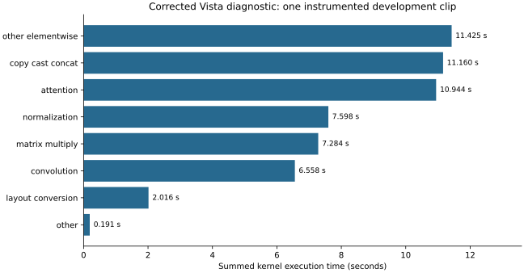

# Measured evidence and study status

## A100 custom kernels and measured RL search — 2026-11-07

The [separate operator study](results/2026-11-07-kernel-tuning/README.md) passed 75 GPU tests with no skipped tests. Two-order confirmation found lower incremental peak allocation than eager for 6 of 6 tested operator workloads; per-workload eager and compiled comparisons retain measured regressions; the original failed numerical test contract is documented separately. A tabular Q learner completed GPU-backed configuration search and equal-budget learned/random/grid evaluation. RL superiority, unseen-shape generalization and whole-video benefits remain unvalidated. Historical compiler timing and quality claims are unchanged. GitHub publication remains unverified.

## H100 performance and memory measured; output quality pending — 2026-10-30

The [H100 performance and memory comparison](results/2026-10-30-h100-tradeoff/README.md)
measures the time to generate one **24-future-frame, 576×1024 video** from a
conditioning image and trajectory using pretrained Vista at fixed 50 sampling
steps with unchanged model weights. The candidate uses `torch.compile`/Inductor
on the denoiser; the reference runs upstream eager inference. Request latency
includes input loading/preprocessing through host-ready generated frames, excluding
model loading, compilation, warmups and output export.

The comparison completed 200 measured requests per role across eight interleaved
blocks on the same physical GPU/runtime. Median latency was 57.33839 s upstream
and 43.66332 s compiled: 23.85% lower.
Measured throughput increased 31.34%, with 7.68% higher peak allocated GPU memory.
The 50 independent scenes were each repeated four times per role; confidence
intervals and block variability are reported. No historical H200 timings are pooled.
This is a performance/memory result with output quality still pending, not a
completed joint speed–quality result. The old qualification remains false and no
quality preservation is claimed. The 16-pair held-out check has not run. The full 179-file local
evidence archive, including all 14 raw proof arrays, was independently hash
verified on October 30. GitHub publication was unverified as of preparation. Earlier sections retain their dated cohort scope.

## Preliminary H200 trade-off snapshot — 2026-10-29

The [recovered H200 comparison](results/2026-10-29-h200-descriptive/README.md) contains one completed
50-request block per role, against the planned 200 requests per role. Median
latency was 53.76568 s upstream and 40.84276 s compiled; observed throughput was 31.65%
higher with 7.68% higher peak allocated memory. These preliminary observations
do not establish the planned headline comparison. The remaining timing blocks,
between-block variability and 16-pair held-out quality check are incomplete.
The partial 35-row compiler block is preserved and excluded. The old qualification
remains false, and no quality-preserving gain is claimed. Its sealed review
rejection and subsequent preference for compiled remain visible with their caveat.
This snapshot concerns only recovered historical H200 evidence; later allocations
or runs are not reported here. Prior sections below retain their dated scope.

## Historical compact H100 update — 2026-10-28

The [compact performance report](results/2026-10-28-h100-performance/README.md) records completed 32-scene development comparisons, an exact eager anchor and a complete compiler semantic diagnostic. The default compiler stays within the declared development metric limits but fails strict pixel equality. Seven blinded static cases are sealed: six accepted ties and one localized geometry difference. After sealing, attribution showed that the reviewer preferred the compiled display in the rejected case. This does not show compiler-induced degradation; the unchanged conservative review gate still rejects the difference. The completed norm qualifier returned qualified:false; its numerical and semantic checks passed, but localized review did not. Held-out quality and repeated headline timing are unfinished; no quality-preserving speedup or GitHub publication is claimed. Compute has been released; the retained 300 GB disk continues to incur storage charges. The earlier reports below retain their dated scope.

## A100 47-step screening snapshot

The [four-scene 47-step A100 report](results/2026-10-28-a100-step47/README.md) records completed
generation, CPU LPIPS/RGB/temporal comparison against the earlier four-scene
math-SDPA eager50 reference, and two independent blind static agent reviews as
of **2026-10-28T04:46:09.012565+00:00**. Both complete evidence archives are locally hash-verified.
Mean LPIPS was 0.000990859 and mean RGB RMSE was 0.003132802. Each reviewer
reported four ties, with the same two cases visually unacceptable on both sides
because of vehicle deformation. Review covered all 24 ordered future frames per
case in downscaled atlases and 13 selected native pairs per reviewer; it did not
include playback or human review. Ties do not establish equivalence or quality.

The 47-step descriptive median request duration was 96.2168 seconds. This short
development screen establishes no matched latency, speedup, calibrated quality,
action, safety, H100, or full-study acceptance. All such gates remain false.
Zero additional thresholded global pixel-change transitions relative to eager50
does not mean no low-change transitions or correct motion. Local specification
builder failure and the separately reviewed alias-preserving repair are retained
in the report and exact historical source archive.

The [32-scene A100 companion](results/2026-10-28-a100-development/README.md) and
[earlier A100 snapshot](results/2026-10-27-a100-pilot/README.md) retain their own
dated evidence and limits. The original A100 default runtime failed exact checks;
the separate math-SDPA exact pass covers one selected development request only.
The [historical helper archive](research/a100-pilot-v1/README.md) is for inspection
and is not runnable after relocation. Frozen d8 source, historical H100 evidence,
and the 18-variant study plan are unchanged. V5's 1,095 CPU tests and five synthetic
CLI checks retain their historical attribution; the six new helper/config copies
received hash checks and syntax parsing only. GitHub publication has not completed.

**Source attribution:** initial-session measurements belong to package `2a8fed43b4f2d13e94f9310e9078cfada379f19d8f2f74107fe1066991b7ff00`. The current study source `d8a32813492c0939a0a91573a945c914938972419946065e6822f6209fa470cb` is a later revision; its expanded GPU results remain in progress. Later discovery entries identify their own producing source. Historical artifacts in `results/2026-10-26-h100/` are unchanged.

The initial session on 2026-10-26 is complete. The original expanded study is now deferred. The separate October 30 performance/memory comparison above is complete; its held-out output-quality check remains pending. The initial-session results concern one selected development clip; no held-out quality or optimization speedup is claimed.

| Experiment | Observed result | Scope |
|---|---|---|
| Corrected upstream agreement | 44,236,800 values exactly equal; max error/RMSE 0 | One candidate, 25 frames, 50 steps |
| Candidate isolation | Both candidates unchanged by reversal; c01 unchanged after c00 action perturbation | Serial `[1,1]`, one request; no action-quality conclusion |
| Conditioning cache | Both candidates exact; 8 embedding hits and 2 posterior hits; key reuse/invalidation pass | Correctness and exercised reuse; no cache speedup claim |
| Corrected Nsight Systems | Denoising 53.336 s within 58.242 s capture; CUDA activity coverage 98.431% | Instrumented request with background transfer; coverage is not SM utilization |
| Corrected memory | Conditioning 52.208 GiB; denoising 20.487 GiB; decode 48.337 GiB | Host-stage allocator peaks; not a batch capacity guarantee |
| Compiler attempt 1 | Fake-tensor tracing assertion after 31 partial graphs | Failed before numerical comparison |
| Compiler attempt 2 | 444 partial graphs; two specialization-limit events; max error 0.178759, RMSE 0.002064 | Failed unchanged exact gate; native attention retained |
| Unprofiled timings | 57.506485, 57.486840, 57.492143 s | Three samples after two warmups; one clip; numerical gate false |

The timing config referenced strict-only evidence, so its combined isolation/development-manifest gate remained false. The saved summary records `headline_eligible=false` and `quality_preserving=false`. Separate successful strict/isolation diagnostics do not rewrite that gate. No p95 or confidence interval is reported from three repeated-clip samples.

Kernel family values are mutually exclusive summed GPU execution durations from one corrected Nsight capture. They are not end-to-end stage times or comparative speedups. Allocation churn is not DRAM traffic. The final autocast-cache clear released 1,024 allocations totaling 3,321,616,896 bytes; that cache is part of upstream baseline fidelity.

The original adapter incorrectly changed gradient flags and grad mode, disabling upstream weight-cast caching. The corrected implementation restored those choices. Its output remained exact on the chosen clip while removing 50,176 copy/cast launches. This was a baseline repair, not an optimization win; historical uncorrected timings are excluded from accepted reference claims.

Data preparation verified 4,358 selected camera images (636,398,932 bytes), with 32 development, 128 evaluation, 16 calibration, 4 smoke, and 16 second-seed evaluation clips. This is data readiness, not completed evaluation.

[Evidence index](results/2026-10-26-h100/README.md) · [Provenance](results/2026-10-26-h100/provenance.json) · [Artifact checksums](results/2026-10-26-h100/checksums.json)

## Expanded-study development baseline

A subsequent upstream run completed 32 development clips from 32 distinct scenes with a descriptive median of 57.312391 s and no OOM or measured recompilation. This run still used historical corrected package `2a8fed43b4f2d13e94f9310e9078cfada379f19d8f2f74107fe1066991b7ff00`. Its numerical gate remained false because no proof was configured; no new-package, speedup, held-out or headline claim follows. [All 32 timing rows and provenance](results/2026-10-26-development-upstream/README.md).

## Block selection for feature reuse

A single development request identified `output_blocks.9` as the largest measured denoiser block. [Instrumented block spans and strict-comparison evidence](results/2026-10-26-block-discovery/README.md) motivate the next experiment; they establish no optimization gain.

## Joint batching screen

The [two-candidate GPU screen](results/2026-10-27-batch2-screen/README.md) exercised actual joint denoising without OOM or fallback and failed the unchanged zero-tolerance numerical check. Perceptual quality and performance remain unestablished. Its producing source is recorded separately from this publication revision.

## Registered compiler discovery

A [scoped registered-einops compiler probe](results/2026-10-27-registered-compiler/README.md) produced 347 stable partial graphs and positive GPU code generation, but failed the unchanged zero-tolerance comparison. Its single measured request was 43.607201 s excluding file decode/export; that historical probe alone established neither quality nor comparative performance. The later October 30 performance/memory result is reported above; held-out output quality remains pending.

## Other measured alternatives

[Eight bounded discovery attempts](results/2026-10-27-discovery-alternatives/README.md) record unsupported BF16 operations, compiler fallback/assertion/OOM failures, and a completed decode-chunk change that failed strict numerical agreement. None establishes an accepted optimization.

## Joint-batch isolation

The [B2 isolation screen](results/2026-10-27-batch2-isolation/README.md) failed exact candidate-order invariance. The unrelated candidate stayed exactly unchanged after the other action changed. This does not establish action adherence or accepted quality.

## Current-source discovery

[All 19 d8 discovery attempts](results/2026-10-27-d8-discovery/README.md) retain failed checkout attempts, compiler exact-comparison failures, successful batch-2/4 capacity screens, batch-8 OOM and a one-step permutation diagnostic. Timings are single-request exploratory observations; no quality-preserving optimization or held-out conclusion is established.

## Development qualification and component diagnostics

See the [32-scene development qualification and diagnostic bundle](results/2026-10-27-development-qualification/README.md). Small differences from generated upstream are reference-preservation evidence only. There is no held-out quality conclusion, candidate-batching acceptance, exact cache claim or final latency speedup in this bundle. The 600-second B5 and B6 attempts are classified as unknown capacity after timeout.

## Input processing screen and completed norm-qualification decision

See the [input pipeline diagnostics](results/2026-10-27-input-pipeline-screen/README.md)
for scoped exact-output checks and the original small-sample timing observations.
Prefetched request latency includes time waiting in the bounded queue; stream
throughput uses the measured completion window. Neither quantity is silently
substituted for the other.

The compact default-compiler norm qualification completed with **qualified:false**. Its numerical and exact semantic checks passed; the conservative localized-review gate rejected one visible difference. After sealing, the reviewer's preferred display was identified as compiled, so this result does not demonstrate compiler-induced degradation. Historical strict-zero failures remain unchanged. That historical qualification adds no held-out acceptance or output-preserving winner. The separate October 30 result above establishes the measured performance/memory comparison; held-out output quality remains pending.
