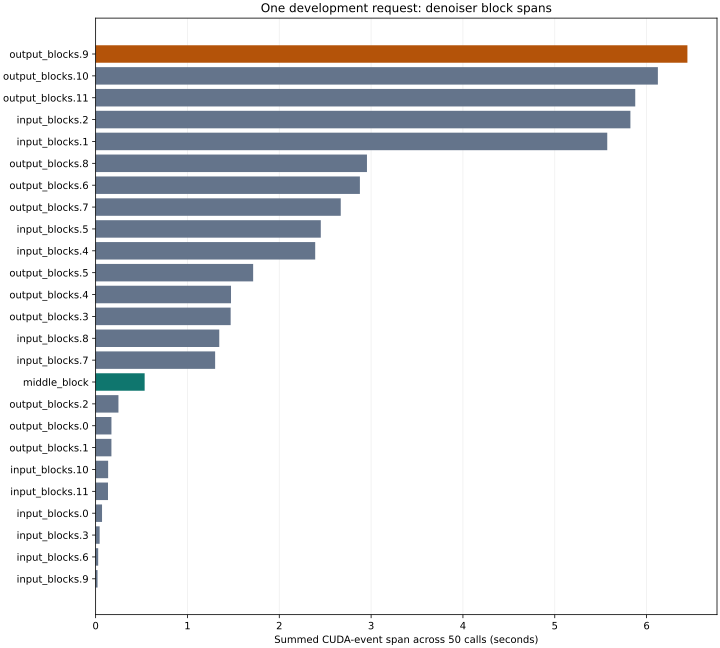

# Development block discovery

On one development request, `output_blocks.9` accounted for 6.444577 s of 52.601414 s instrumented denoising time (12.25%). The middle block accounted for 0.533801 s. Each of the 25 blocks ran 50 times. This evidence selected `output_blocks.9` for the subsequent feature-reuse experiment.

Cold and instrumented outputs each passed the unchanged zero-tolerance comparison to the saved upstream output. The executing source was `2a8fed43b4f2d13e94f9310e9078cfada379f19d8f2f74107fe1066991b7ff00`; the helper and derived runtime fingerprints are recorded separately. Metadata transfer hashes are verified. Raw arrays are excluded.

Removing half of this block's work would ideally avoid at most 3.222289 s, before cache or copy overhead. No reuse optimization was measured here, and no quality or speedup claim is made.

[Raw numeric spans and provenance](summary.json). Instrumentation adds overhead; summed block spans exclude work outside the hooks.
