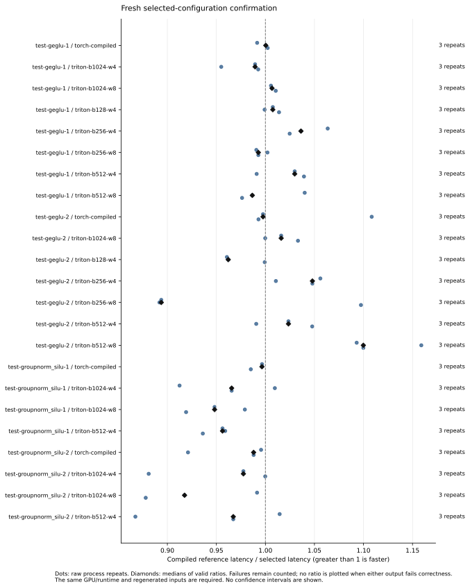

# Operator configuration search on RTX PRO 4500

Neither LLM selector reduced mean table regret relative to fixed compiled PyTorch in this compact comparison. Both frequently repeated configurations they had already tried. The release contains the measured operator table, policy trajectories and reproduction commands.

## Measurements

The suite contains 12 seeded-tensor workloads across GEGLU and GroupNorm+SiLU: six training, two validation and four test tasks. Each task has nine candidates—compiled PyTorch and eight Triton launch configurations—plus an eager reference.

Three fresh processes measured all 120 task/configuration cells on one NVIDIA RTX PRO 4500 Blackwell. All **360 measurements passed the operator numerical checks**, with zero recorded execution failures. The FP16 check uses `rtol=0.002` and `atol=0.002`, requires matching shape/dtype and finite outputs, and verifies input immutability. Each successful measurement contains 30 CUDA-event samples after five warmups: **10,800 timed samples** in total.

Runtime: PyTorch `2.10.0+cu128`, Triton `3.6.0`, CUDA `12.8`, driver `595.112.07`. Latency measures one isolated operator invocation. Compilation, input setup, correctness checks and warmup are excluded from latency and included in preparation/run time. Memory measures peak live allocation above resident inputs, including the output.

- [Measured table and per-cell variability](table.json)
- [Latency and correctness matrix](figures/primary/operator-latency-correctness.svg)
- [Policy records](related/) and [primary regret curves](figures/primary/policy-regret-vs-budget.svg)

## Policy comparison

The primary comparison uses the first three episodes per test task for every policy: **12 episodes and 48 turns per policy**, with four turns per episode. Matching task/repeat pairs use the same starting measurement-repeat index; repeated queries cycle through the three recorded repeats. Regret is the selected configuration's median paired cost minus the best admissible table cost, averaged equally across tasks. The objective here is latency; lower regret is better.

| Policy | Final mean regret | Repeated actions / 48 turns |
|---|---:|---:|
| Fixed compiled PyTorch | 0.015455 | 36 |
| Grid | 0.014413 | 0 |
| Random | 0.009773 | 0 |
| GPT-5.4 mini | 0.016022 | 30 |
| GPT-5.4 nano | 0.016022 | 20 |

There were no rejected policy actions or failed candidate queries. A repeated action means choosing a configuration already queried in that episode. Fixed compiled intentionally spends all four turns on its one configuration.

The [supplementary baseline comparison](figures/baselines-20/policy-regret-vs-budget.svg) retains all 20 episodes per task. Its final mean regrets are **0.015455** for fixed compiled, **0.014533** for grid and **0.016853** for random. Random's lower regret in the first-three comparison does not persist over 20 episodes. These are descriptive results on a finite table; policy episodes do not add independent GPU timing samples.

The LLMs were pretrained configuration selectors. No policy training was performed. The recorded seed controls table sampling; API calls use the models’ default sampling settings.

| Model snapshot | Input / output price per million tokens | Calls | Input / output tokens | Usage cost |
|---|---:|---:|---:|---:|
| `gpt-5.4-mini-2026-03-17` | $0.75 / $4.50 | 48 | 37,864 / 796 | $0.0319800 |
| `gpt-5.4-nano-2026-03-17` | $0.20 / $1.25 | 48 | 38,312 / 672 | $0.0085024 |

Total API usage cost at these rates was **$0.0404824**, using reported token counts and standard input prices without caching discounts. Prices and budgets are recorded with each policy run.

## Replay

From the repository root, after installing the project and tuning extension:

```sh
python -m drivebench_tuning.replay_cli \
  --table results/2026-11-20-operator-search-rtx-pro-4500/table.json \
  --split test --trials 4 --repeats 20 --seed 1901 \
  --output operator-replay
```

The `measured_replay` backend returns recorded outcomes and retains their source measurement IDs. See [collection, LLM evaluation and confirmation instructions](../../docs/measured-operator-search.md) for the complete interfaces.

## Fresh confirmation

The 23 distinct task/configuration pairs selected across all 264 policy episodes were frozen before confirmation. Three new processes measured each selected configuration alongside eager and compiled references, with role order rotated across repeats. All **207 fresh measurements passed**; the records contain another **6,210 CUDA-event samples**.

Confirmation used the same physical GPU, runtime, source and regenerated input hashes as collection. Selection was not updated using these results. The raw confirmation records for [repeat 0](related/confirmation-0/), [repeat 1](related/confirmation-1/) and [repeat 2](related/confirmation-2/), together with the [complete figure data](figures/primary/analysis.json), retain every process result.



Dots are individual process ratios; diamonds are medians. Values above one indicate lower selected-configuration latency than the paired compiled reference. Small differences are descriptive; three process repeats do not establish a general kernel or policy advantage.

This dataset measures isolated operator correctness and execution cost. End-to-end Vista performance and video-quality evaluation require their own measurements.
