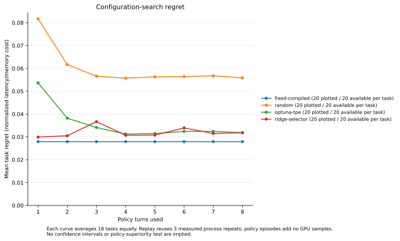
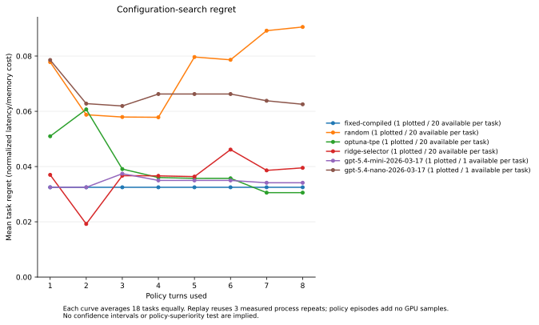
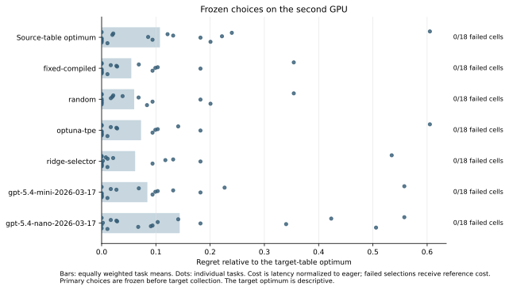

# Operator configuration benchmark: RTX PRO 4000

This dataset provides measured operator costs for evaluating configuration selectors without a GPU. It includes 60 workloads, 24 Triton launch configurations, compiled PyTorch, an eager reference, and three fresh-process repeats. Six selectors were evaluated with an eight-trial budget.

## Download and run

The [data archive](data.tar.gz) contains the measured table, individual CUDA-event samples, correctness records, trained cost model, policy trajectories, fresh confirmation and RTX 4090 transfer measurements. The [file manifest](dataset-manifest.json) records the extracted paths, sizes and SHA-256 hashes. Extract it from the repository root:

```sh
tar -xzf results/2026-11-23-operator-generalization-pro-4000/data.tar.gz -C results
python -m pip install -e . -e './extensions/kernel_tuning[search]'
python -m drivebench_tuning.generalization_cli run \
  --suite operator-generalization-v2 \
  --table results/2026-11-23-operator-generalization-pro-4000/table.json \
  --protocol protocols/operator-generalization-v2-compile-isolation-v1.json \
  --output ./policy-comparison
```

See the [Gymnasium example](../../docs/operator-generalization.md#use-the-gymnasium-interface) for connecting another policy. The [frozen protocol](../../protocols/operator-generalization-v2-compile-isolation-v1.json) specifies the collection and comparison before measurement.

## Coverage

| Split | Shape families | Workloads including dtypes |
| --- | ---: | ---: |
| Training | 10 | 30 |
| Validation | 4 | 12 |
| Test | 6 | 18 |
| Total | 20 | 60 |

GEGLU and GroupNorm+SiLU each contribute ten shapes in float16, bfloat16 and float32. Every version of an exact shape stays in one split. Both operators occur in every split: this is a constructed shape-family holdout, not an unseen-operator test.

The 24 Triton configurations combine block sizes 64, 128, 256, 512, 1024 and 2048 with one, two, four or eight warps. They produce **1,440 workload/Triton-configuration pairs**, not 1,440 distinct kernel implementations. Adding compiled PyTorch and eager gives **1,560 cells**. Three process repeats produce **4,680 measurements**, all of which passed numerical checks.

Each measurement contains five warmups and 30 timed invocations, totaling 140,400 CUDA-event samples. Compilation, input setup, correctness checking and warmup are excluded from steady-state latency and included in preparation time. The runtime used NVIDIA RTX PRO 4000 Blackwell, PyTorch 2.10.0+cu128, Triton 3.6.0, CUDA 12.8 and Python 3.12.3, with one Inductor compilation thread. Individual invocation samples within one process are not independent process repeats.

Numerical checks compare each candidate with the eager operator on the same seeded inputs. The explicit relative/absolute tolerances are 0.002/0.002 for float16, 0.02/0.02 for bfloat16 and 0.00002/0.000003 for float32. These checks cover operator outputs, not perceptual video quality.

## Twenty-episode policy comparison

Each of four methods received eight trials on each of 18 test workloads, with 20 episodes per workload: 360 episodes and 2,880 turns per method. The ridge selector was fitted only to the 30 training workloads; validation outcomes were unused. This is supervised cost-model training, not PPO or another RL training algorithm.

| Policy | Mean final table regret | Repeated actions / 2,880 turns |
| --- | ---: | ---: |
| Compiled-query baseline | 0.027931 | 2,520 |
| Random | 0.055878 | 0 |
| Optuna TPE | 0.031880 | 1,434 |
| Train-only ridge selector | 0.031822 | 0 |

The compiled-query baseline had the lowest mean regret. The ridge selector's mean regret was 43.05% below random search and 0.18% below TPE. These are relative changes in regret, not latency speedups; the small TPE difference does not establish superiority.

Cost is the median of the three process-paired candidate/eager latency ratios. Table regret is the selected configuration's cost minus the smallest valid cost among all candidates and eager. The agent selects from sampled observations; analysis then scores that choice against all three process repeats. This can make regret rise after an apparently favorable observation. Repeated suggestions consume turns and expose another recorded process observation; they are not free retries or fresh GPU measurements. The compiled-query baseline (raw identifier `fixed-compiled`) starts with eager, queries compiled and retains its observed incumbent; its final choice can therefore be eager.



[Per-workload latency and correctness](figures/cpu-20/operator-latency-correctness.svg) · [Plot data](figures/cpu-20/analysis.json)

## Matched LLM comparison

The pretrained `gpt-5.4-mini-2026-03-17` and `gpt-5.4-nano-2026-03-17` selectors each ran one episode per test workload. The table below restricts every method to its first episode on each workload: 18 episodes and 144 turns per method.

| Policy | Mean final table regret | Repeated actions / 144 turns |
| --- | ---: | ---: |
| Compiled-query baseline | 0.032494 | 126 |
| Random | 0.090530 | 0 |
| Optuna TPE | 0.030551 | 71 |
| Train-only ridge selector | 0.039528 | 0 |
| GPT-5.4 mini | 0.034129 | 116 |
| GPT-5.4 nano | 0.062542 | 100 |

Neither LLM improved on the compiled-query baseline in this panel. One episode per workload supports a demonstration of agent behavior, not a claim of model superiority. All policy actions were accepted and all queried records passed correctness. The release retains all 1,476 episodes across both comparison panels' source reports; the matched panel reuses the first CPU episodes rather than adding new ones.



[Matched-panel plot data](figures/llm-matched-1/analysis.json)

## Fresh frozen-selection performance

One modal final choice per policy and test workload was frozen before confirmation. The 108 choices reduced to 42 distinct workload/configuration pairs. Each pair was remeasured alongside eager and compiled in three fresh processes on the same GPU and runtime: **378 measurements**, all numerically correct.

The ratio below is compiled-reference latency divided by selected latency; greater than one is faster. For each workload, take the median of its three process ratios, then the unweighted geometric mean over 18 workloads. Process ranges show the three separately aggregated process results.

| Frozen policy choices | Geometric mean ratio | Process aggregate range |
| --- | ---: | ---: |
| Compiled-query baseline | 1.074× | 1.070–1.074× |
| Random | 1.053× | 1.048–1.053× |
| Optuna TPE | 1.064× | 1.061–1.065× |
| Train-only ridge selector | 1.058× | 1.051–1.065× |
| GPT-5.4 mini | 1.051× | 1.034–1.051× |
| GPT-5.4 nano | 0.988× | 0.980–0.994× |

These are descriptive results for frozen selections, including eager fallbacks. Policies sometimes select the same pair and share its confirmation measurements. Selecting compiled still triggers a separate measurement, so its ratio need not equal one exactly. The [confirmation plot](figures/cpu-20/confirmation-vs-compiled.svg) shows every pair and process, including slower selections; the ranges above are not confidence intervals.

## Transfer to RTX 4090

The identical source, seeded inputs and 18 test workloads were measured on an NVIDIA GeForce RTX 4090 in three fresh processes. All **1,404 target measurements** passed numerical checks. Training and validation tasks were not collected on this GPU. The model and all policy choices stayed frozen from the primary cohort.

Mean per-workload Spearman rank correlation was **0.301** (median 0.280; range −0.037 to 0.715). Rankings cover the 25 candidates that passed every repeat on both GPUs, with average ranks for exact ties; eager is excluded from this rank calculation. Only **6 of 18** source-table optima remained target-optimal when eager is also allowed as a choice. Ties between optima use eager first, then fixed suite order.

| Frozen source choice | Mean target table regret |
| --- | ---: |
| Source-table optimum | 0.107481 |
| Compiled-query baseline | 0.054697 |
| Random | 0.059972 |
| Optuna TPE | 0.072668 |
| Train-only ridge selector | 0.061835 |
| GPT-5.4 mini | 0.084347 |
| GPT-5.4 nano | 0.143962 |

Target regret is the transferred choice's median paired normalized cost minus the target-table optimum, including eager. It is a unitless difference, not a percentage slowdown. The source optimum had positive target regret on 12 workloads. Policies were not rerun on the target; these values score their already-frozen modal choices, not another set of search episodes.



[Per-workload rank correlation](figures/transfer/cross-gpu-rank-correlation.svg) · [Transfer plot data](figures/transfer/analysis.json)

The comparison covers one source and one target GPU/runtime cohort, with six shape families and three dtypes each. It describes this transfer; it does not isolate hardware as the sole cause or establish a policy-superiority result.

## Available headroom

On the finite test table, choosing the best configuration after inspecting every cell reduces normalized cost relative to compiled by 8.83% on average across workloads (median 1.65%, maximum 42.27%). The chosen configurations are Triton for nine workloads, compiled for five and eager for four. This descriptive oracle uses the same three process repeats for selection and scoring; it is not a search-policy result or an independently confirmed speedup.

The measurements apply to these operators, shapes and runtime. Separate [Vista coverage](../../docs/modern-vista.md) does not turn operator improvements into an end-to-end video-model claim.
