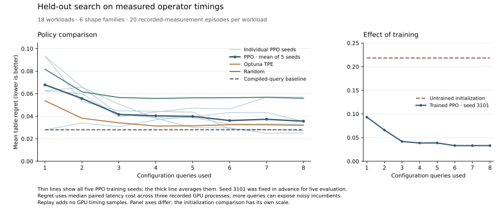
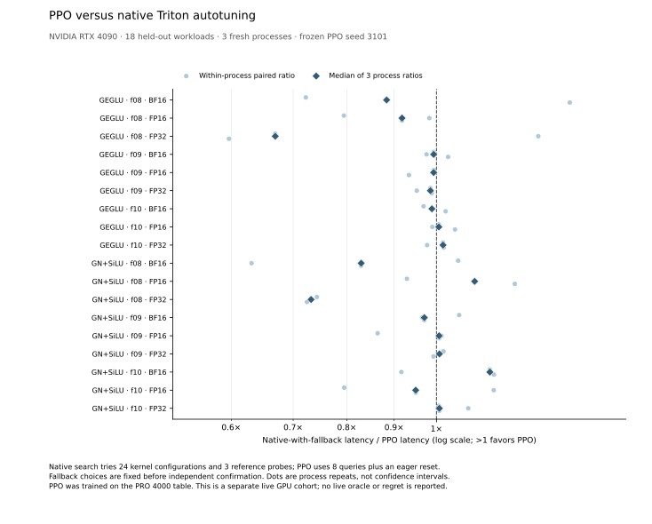

# PPO and native-autotuning supplement

This supplement contains PPO training and evaluation on the measured operator table, plus a live comparison with native Triton autotuning on an RTX 4090. Checkpoints, trajectories and measurement records accompany both studies.

## PPO on the measured table

The training split contains 30 workloads and 2,340 recorded GPU measurements. Five prespecified seeds completed 102,400 environment steps each (512,000 total) with fixed hyperparameters. Checkpoints were saved before TEST evaluation, and the results include all five seeds.

Each trained checkpoint and one untrained initialization received twenty eight-query episodes on each of eighteen held-out workloads: **2,160 evaluation episodes** in total. The episodes reuse three recorded GPU-process repeats from the RTX PRO 4000 table. The test split contains six shape families, each in three dtypes.

| Method | Mean final table regret |
| --- | ---: |
| Compiled-query baseline | 0.027931 |
| Optuna TPE | 0.031880 |
| Ridge selector | 0.031822 |
| Random | 0.055878 |
| PPO, mean of all five training seeds | 0.035556 |
| Untrained initialization, seed 3101 | 0.218278 |

The five trained-seed means are 0.033024, 0.025118, 0.027289, 0.035376 and 0.056971 (sample standard deviation 0.012672). Their mean is below the untrained initialization and above TPE and the compiled-query baseline. The paired mean PPO-minus-TPE difference is 0.003676, with a descriptive six-family bootstrap interval of [−0.034030, 0.042650]. The interval conditions on fixed checkpoints and recorded measurements; replay adds no independent GPU samples.



[Training settings and implementation](../../docs/ppo-training.md) · [Seed spread](../../reports/figures/ppo-seed-spread.svg) · [Analysis JSON](replay-analysis.json)

## Live GPU comparison

PPO seed 3101 was chosen before training. Its checkpoint was evaluated on an NVIDIA GeForce RTX 4090 with PyTorch 2.10.0 and Triton 3.6.0. Three fresh processes each ran eight queries per workload on the eighteen held-out workloads using the original benchmark inputs. Policy parameters remained fixed while the environment supplied live GPU feedback. Training used the separate RTX PRO 4000 table.

Native `triton.autotune` evaluated all 24 Triton configurations through the same whole-operator wrappers. For the fallback comparator, three additional probes selected among eager, compiled and the native-selected kernel before final confirmation. This gives native search access to the eager and compiled choices also available to PPO.

| Comparator | Comparator latency / PPO latency | Descriptive 95% interval |
| --- | ---: | ---: |
| Native autotuning, Triton kernels only | 1.089 | [1.019, 1.163] |
| Native autotuning with eager/compiled fallback | 0.948 | [0.882, 1.009] |
| Compiled reference | 1.039 | [0.981, 1.141] |

Ratios above one favor PPO. The ratio changes from 1.089 for native kernel selection to 0.948 when eager and compiled fallbacks are available. Search budgets differ: native selection uses 24 configuration trials and three fallback probes; PPO uses eight queries plus an eager reset.

Each workload received fresh eager, compiled, native-selected and PPO-selected confirmations. All **216 confirmations passed numerical checks**; all 1,296 native configuration trials and 432 PPO queries succeeded. Measurements contain thirty synchronized CUDA-event samples after five warmups. Timed invocations exclude initialization, compilation, correctness checks and warmups. CPU inference with the saved checkpoint reproduced all 432 recorded actions; the [verification receipt](frozen-policy-verification.json) records the checkpoint, manifest and verifier hashes.

The summary takes the median of three within-process latency ratios per workload, then their geometric mean. Intervals resample six shape families with their three dtypes together and condition on this GPU allocation and checkpoint. Live regret requires an independently measured full-grid oracle, which was outside this experiment. The numerical gate evaluates isolated-operator agreement with eager; perceptual quality and end-to-end Vista performance were not measured.

Median instrumented selection time per workload/process was 10.27 seconds for native tuning and 4.38 seconds for PPO; reference fallback probes added a median 1.70 seconds. Selection order alternates, and methods share compilation caches within a process. These wall times include compilation and unequal logging costs: PPO's evaluator journals every CUDA sample, whereas native tuning journals each configuration. They exclude offline PPO training and final confirmation, and cannot isolate intrinsic search efficiency or cold compilation.



[Instrumented tuning cost](../../reports/figures/ppo-tuning-cost.svg) · [Live analysis JSON](live-analysis.json)

### Live data and reproduction

The [live evidence archive](live-data.tar.gz) is 4,666,784 bytes, SHA-256 `739b8775ed7e456c33bc01050e6645400e0fa3c0c2e7ac35e2549cc4d9a951d7`. Its [inventory](live-archive-members.json) records all 24 members, expanding to 61.76 MB. It includes the three scientific journals, all observations and actions, configuration timings, correctness results, confirmation samples, exact native source, input bindings, scientific protocol and offline audit code.

```sh
tar -xzf results/2026-11-24-ppo-native-autotune/live-data.tar.gz -C results
PYTHONPATH=extensions/kernel_tuning python \
  results/ppo-native-live-2026-11-23/reproduce_analysis.py \
  --output live-summary.json
python scripts/plot_ppo_supplement.py --kind live \
  --analysis live-summary.json --live-gpu-label 'RTX 4090' --output live-figures
```

The offline audit reconstructs native and fallback choices, PPO incumbents, observations and rewards from the measurements. Public files replace physical GPU identifiers and the cohort hash while retaining measurement values, trial IDs, inputs and decisions. The export receipt records the file-hash mapping; provider and host-operation files are excluded.

## Download and reproduce PPO replay

The [PPO evidence archive](ppo-data.tar.gz) is 29,074,068 bytes, SHA-256 `ff7a0e812d2b3a06272def63556c68580be5097b2a0e7694ba642d3041031917`. It expands to 518 MB. Its [inventory](ppo-archive-members.json) records all 71 member hashes.

The archive includes five trained checkpoints, the untrained reference, all training and evaluation journals, four original CPU baseline reports, the exact pre-training source, and a measured-row mapping to the public GPU dataset. Checkpoints and scientific records are byte-exact; one diagnostic log has its workstation prefix removed. Original measurement IDs are retained.

From the repository root:

```sh
python -m pip install -e './extensions/kernel_tuning[rl,search]'
tar -xzf results/2026-11-24-ppo-native-autotune/ppo-data.tar.gz -C results
PYTHONPATH=extensions/kernel_tuning python \
  results/ppo-training-2026-11-23/reproduce_analysis.py \
  --output replay-summary.json
python scripts/plot_ppo_supplement.py --kind replay \
  --analysis replay-summary.json --output replay-figures
```

The archived reports retain the original measured-table hash. `source-bindings.json` maps their rows to the public table, which pseudonymizes physical GPU identifiers and preserves numerical measurements, inputs and choices. Training on the public table records a new protocol with its own table and source hashes; see the [training commands](../../docs/ppo-training.md#reproduce-training-and-evaluation).

The archive includes the original summary and a metadata correction distinguishing trained input reports from the summarization step. An offline verification recomputed all 512,000 recorded training transitions and every evaluation trajectory.
