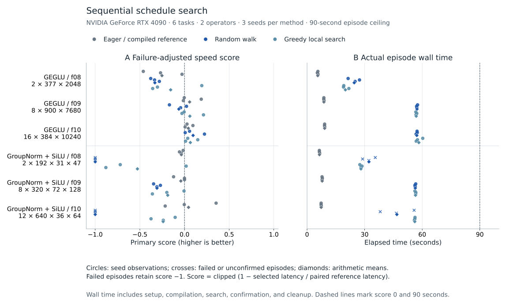

# Live sequential schedule search

The fixed eager/compiled reference had the highest mean final score in this six-workload RTX 4090 comparison. Greedy local search confirmed every submission but did not improve the observed mean; its paired difference from the reference was uncertain. Random walks hit the query timeout in six of 18 episodes.

This is the first measured comparison for `DriveBench/KernelSchedule-v0`. Actions change the current kernel schedule, and later measurements evaluate that changed program. The older configuration-bandit dataset and its PPO/LLM results are separate.

## Results

Each method received the same six float16 TEST shape families, three search/timing seeds and a 90-second episode ceiling. Input seeds were fixed per workload. Higher score is better.

| Method | Mean score | 95% interval | Confirmed | Median episode time | Exploration queries |
| --- | ---: | ---: | ---: | ---: | ---: |
| Fixed eager/compiled reference | −0.031 | [−0.145, 0.063] | 18/18 | 7.6 s | 0 |
| Greedy local search | −0.164 | [−0.370, 0.006] | 18/18 | 56.2 s | 1,679 |
| Random walk | −0.435 | [−0.776, −0.107] | 12/18 | 56.0 s | 1,163 |

The score is `clip(1 − final candidate median / fresh reference median, −1, 1)`, with −1 for failed or unconfirmed episodes. It is neither oracle regret nor the environment's cumulative reward. The reference uses whichever correct eager or compiled implementation had the lower reset median, then keeps that role fixed. Its two final timing batches are fresh, so its measured score need not equal zero.

The paired reference-minus-greedy difference was 0.133, with a 95% interval of [−0.066, 0.351]. Reference-minus-random was 0.404 [0.074, 0.767]. These are exploratory paired hierarchical-bootstrap intervals from six shape families and three nested seeds, using the prospectively fixed 10,000 draws. They do not treat 54 episodes as independent workloads.



All six failed episodes were random walks on GroupNorm+SiLU families f08 and f10, one per search seed. Each exceeded the full 15-second query limit; the cause within that interval was not established. Every failed attempt remains in the score and trajectories. No episode exceeded its 90-second ceiling. The 128-query cap ended exploration in six greedy episodes and three random episodes before the time limit; the table reports actual time used.

## Task and measurement protocol

The schedule state includes fusion, per-stage block sizes and warp counts, and GroupNorm reduction settings. Eighteen actions edit that state, measure it, or submit it. For example, unfusing enables activation-stage edits; increasing the main block before versus after unfusing produces different schedules. The action graph contains 812 GEGLU schedules and up to 25,984 GroupNorm+SiLU schedules, subject to workload constraints. These are structural counts, not exhaustive timing measurements.

Each episode starts a fresh worker with separate TorchInductor and Triton filesystem caches. Compilation, reference setup, policy execution, legal edits, failed queries, confirmation and teardown consume wall time. An exploration query is admitted only if its full 15-second limit and a 20-second final reserve fit before and after navigation. Two warmups precede seven CUDA-event samples per measurement. The policy receives one sampled timing; the complete sample vector is retained. Repeated queries obtain fresh measurements.

Random walk samples a legal edit between measurements. Greedy local search visits seed-shuffled legal neighbors of its incumbent and restores it through charged legal edits after non-improvements. Both retain the best sampled correct schedule and restore it before submission. Final scoring measures the fixed reference role and selected schedule afresh; those observations do not change the selection.

Correctness requires matching output shape and dtype, finite values and comparison to eager PyTorch. The float16 contract is `rtol=2e-3, atol=2e-3`. The separate [CUDA validation](cuda-validation.json) passed all 28 representative tests across dtypes, fusion/reduction paths, stage launch settings, tails, streams, input checks and the environment lifecycle. This does not validate every reachable schedule or video quality.

The recorded runtime was one NVIDIA GeForce RTX 4090, PyTorch 2.10.0+cu128, Triton 3.6.0, CUDA 12.8 and Python 3.12.3. See [the frozen protocol](../../reports/sequential-schedule-study-v2/protocol.json), [analysis plan](../../reports/sequential-schedule-study-v2/analysis-plan.json), and [environment specification](../../extensions/kernel_tuning/docs/sequential-schedules.md).

## Data and reproduction

- [Summary and paired intervals](summary.json), [all 54 episodes with final timing samples](episodes.json), and [CSV](episodes.csv).
- [All 16,485 parent-journal events](trajectories/trajectories.jsonl.gz): schedule edits, measurements, raw samples, elapsed costs, rewards and failures. [Trajectory provenance](trajectories/provenance.json) describes the two separately ordered event streams; their overlapping costs must not be added together.
- [Frozen source](source/source-payload.tar.gz) and [file manifest](source/source-manifest.json). Archive ownership and timestamps are normalized; [all source bytes are preserved](source/public-repack.json).
- [SVG](figures/sequential-schedule-study.svg), [PDF](figures/sequential-schedule-study.pdf), and [plot provenance](figures/plot-receipt.json).

From the repository root, reproduce the scores and registered intervals using only Python's standard library:

```sh
python3 scripts/recompute_schedule_results.py \
  --summary results/2026-11-26-sequential-schedules/summary.json \
  --episodes results/2026-11-26-sequential-schedules/episodes.json
```

This recomputes statistics from the public sample arrays and published outcome flags. The original export separately checks those outcomes against the complete measurement journals and frozen source/runtime identities. A [separate local reconstruction](verification.json) reproduced the scores and intervals directly from those journals. The [export manifest](export-manifest.json) and [provenance](provenance.json) bind the downloadable records; no private account access is needed to reproduce the statistics.

To regenerate the figure, install Matplotlib and choose a new output directory outside the result tree:

```sh
python3 scripts/plot_schedule_study.py \
  --summary results/2026-11-26-sequential-schedules/summary.json \
  --episodes results/2026-11-26-sequential-schedules/episodes.json \
  --output ./schedule-plots
```

For new GPU measurements or a new policy, use the [collection protocol](../../reports/sequential-schedule-study-v2/README.md#reproduce) and [submission instructions](../../CONTRIBUTING.md#submit-a-sequential-schedule-policy). Record a new runtime cohort and prospective protocol; do not pool it into this result.

## Scope

This study evaluates simple search baselines on two known operators and one GPU. It trains no sequential RL policy, measures no exhaustive oracle, and establishes neither unseen-operator transfer nor end-to-end Vista speed or quality. The small number of task families limits uncertainty estimates. A stronger optimizer can be compared through the same interface and budget accounting.

The earlier v1 comparison was interrupted after 13 attempts because its admission rule shortened queries near the final reserve. Its evidence remains preserved separately. V2 prospectively corrected that rule while retaining the tasks, seeds, policies, budgets and scoring; the attempts are not pooled. See the [revision history](../../reports/sequential-schedule-study-v2/README.md#revision-history).
